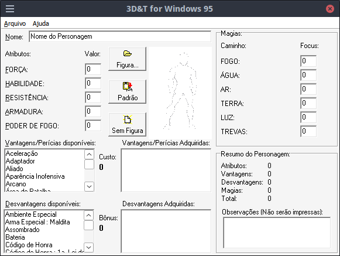

# 3D&T for Windows 95

Código-fonte histórico do programa **3D&T for Windows 95 (3dT)**, desenvolvido por **Reverendo Gunfighter** no final da década de 1990.

Este repositório existe apenas para preservação do software e de seu código-fonte original.

## Sobre o programa

O 3dT foi desenvolvido em **Object Pascal**, utilizando **Borland Delphi 2.0**, para Windows 95.

O código utiliza a VCL clássica do Delphi e componentes de banco de dados baseados no Borland Database Engine (BDE).

Principais características do ambiente original:

- Borland Delphi 2.0
- Object Pascal
- Windows 95
- VCL
- Borland Database Engine (BDE)
- Aplicação Win32

## Preservação

Os arquivos originais distribuídos com o programa e com seu código-fonte foram preservados sem modificações intencionais.

Isso inclui:

- código-fonte;
- formulários Delphi;
- arquivos de projeto;
- executável original;
- bibliotecas;
- arquivos de dados;
- documentação original.

Os arquivos README e demais documentos incluídos na distribuição original permanecem intactos.

Este `README.md` foi adicionado apenas para documentar o conteúdo do repositório no GitHub.

## Compilação

O projeto foi originalmente criado com **Borland Delphi 2.0**.

A compilação no ambiente original provavelmente requer:

- Delphi 2.0;
- Borland Database Engine;
- ambiente Windows compatível.

Versões posteriores do Delphi podem exigir ajustes, principalmente devido à dependência do BDE.

A portabilidade para Lazarus/Free Pascal também é possível, mas requer adaptação da VCL para LCL e substituição da camada de banco de dados baseada no BDE.

## Arquivamento

Este repositório é mantido como arquivo histórico e não possui desenvolvimento ativo.

Após sua publicação, o repositório será arquivado para preservar o estado original do material.

## Créditos

Código original e programa:

**Reverendo Gunfighter**

Este repositório apenas preserva e disponibiliza o material histórico.
